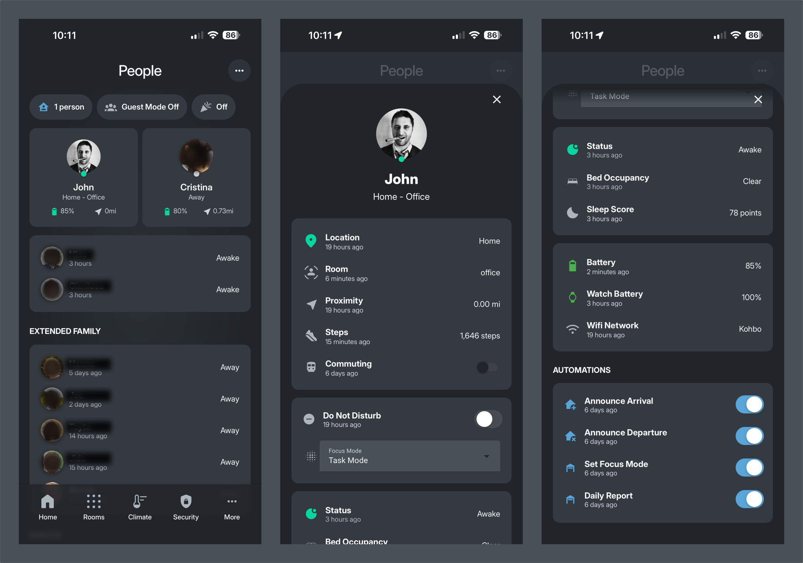

# People

[Back to main README](../README.md)

This document explains how people are modeled in my Home Assistant configuration.

## Overview

Each person in my household has a rich set of sensors and states that drive automations. Beyond the basic Home Assistant [Person integration](https://www.home-assistant.io/integrations/person/), I've created custom template sensors that aggregate multiple data points into a single "person sensor."

---

## Person Sensor

The person sensor extends the standard person entity with additional attributes useful for automations.

```yaml
template:
  - sensor:
      - name: "John Person"
        unique_id: john_person
        state: "{{ states.person.john_koht.state }}"
        attributes:
          unlock_privilege: "{{ states.input_boolean.john_unlock_privilege.state }}"
          fingerprint_id: !secret john_fingerprint_id
          avatar: "{{ states.person.john_koht.attributes.entity_picture }}"
          room_presence: "{{ states.sensor.john_room_presence.state }}"
```

| Attribute | Description |
|-----------|-------------|
| `state` | Home/Away status from the base person entity |
| `unlock_privilege` | Whether this person can unlock doors |
| `fingerprint_id` | Biometric ID for fingerprint locks |
| `avatar` | Profile picture URL |
| `room_presence` | Current room based on BLE tracking |

---

## Key States

Each person has several states tracked through `input_select` entities:

| State Type | Options | Purpose |
|------------|---------|---------|
| **Home Status** | Home, Away, Just Arrived, Just Left | Presence with transition states |
| **Sleep Status** | Awake, Just Laid Down, Sleep, Just Got Up | Sleep tracking for bedroom automations |

The "Just Arrived" and "Just Left" states, inspired by [Phil Hawthorne's methodology](https://philhawthorne.com/making-home-assistants-presence-detection-not-so-binary/), prevent false automations when someone briefly leaves and returns (e.g., taking out trash, getting something from the car).

---

## Anatomy of a Person: John

Here's how a typical day flows through the system, showing how person states drive automations throughout the house.

### Morning Wake Up

The FSR sensor on my bed detects I'm no longer lying down. My sleep state transitions:

**Sleep** → **Just Got Up** → **Awake**

This triggers a cascade:
- Main bedroom transitions from **Bedtime** to **Wake** mode
- Lights gradually brighten (sunrise simulation)
- After a few minutes, the bedroom returns to **Auto** mode

Meanwhile, the house checks whether an adult at home is awake. One is enough (before noon): bedtime ends, and the house goes to **Quiet** if the kids are still asleep, otherwise **Auto**.

### Leaving for Work

I grab my keys and head out. The system detects I've left:

**Home** → **Just Left**

The house announces: *"John just left"*

After ~5 minutes with no return:

**Just Left** → **Away**

The house checks: *Is anybody still home?* If my wife left earlier, `input_boolean.house_occupied` turns off, triggering:
- All rooms transition to **Away** mode
- Lights turn off throughout
- Alarm panel arms
- Doors lock

### Arriving Home

My phone's GPS crosses the home zone. The companion app reports I'm home:

**Away** → **Just Arrived**

Automations fire immediately:
- Garage door opens (detected I'm arriving by car)
- Garage and mudroom lights turn on
- House announces: *"John just arrived"*

After ~5 minutes:

**Just Arrived** → **Home**

### Evening - Do Not Disturb

I hop on a video call in the office. My camera or mic turns on (the work laptop sets `input_boolean.john_dnd`; the personal Mac reports its own camera/mic sensors):

`binary_sensor.john_dnd_active` → **on**

The Office responds by entering **DnD** mode:
- Music stops
- Red light turns on outside the office
- TTS messages are blocked to office speakers

When the call ends and the camera and mic turn off:

`binary_sensor.john_dnd_active` → **off**

The Office returns to **Auto** mode.

### Bedtime

I get into bed. The FSR sensor detects occupancy:

**Awake** → **Just Laid Down** → **Sleep**

The main bedroom transitions to **Bedtime** mode:
- Lights dim to nightlight level
- TTS disabled
- Motion automations adjusted for nighttime

The house checks: *Is everybody sleeping?* When my wife also goes to bed, `sensor.everybody_sleeping` becomes true:
- House enters **Bedtime** mode (the house mode is derived from state by one resolver, `packages/house/modes/house_mode_resolve.yaml`)
- All non-bedroom rooms turn off
- Alarm panel arms (night mode)
- Doors verified locked

---

## House-Level Sensors

These sensors aggregate individual person states:

| Sensor | Description |
|--------|-------------|
| `sensor.anybody_sleeping` | True if any person is asleep |
| `sensor.everybody_sleeping` | True if all persons are asleep |
| `sensor.everybody_awake` | True if all persons are awake |
| `input_boolean.house_occupied` | True if anyone is home |

---

## Medication Timing and Skipping

Nino's medication reminder (`packages/people/nino/medication_reminder/`) prompts for each dose, snoozes, and escalates a late dose with a critical push.

- **No-school days.** When `binary_sensor.nino_school_day` is off (weekends, breaks, summer, holidays), dose 1 is not prompted before the "No school earliest" time in the Nino popup (08:00 when unset), its escalation counts from that time, and snoozes are 30 minutes instead of 15. Dose 2 only gets the longer snooze. If the school-day sensor is unavailable, the school-day timing is used.
- **Skipping a dose.** Tap Skip Dose on the reminder or critical push, the Skip button on the notifications popup card, or turn on "Dose n skipped" in the Nino popup. A skipped dose is not taken: supply is not used, and its reminders and escalation stop. Skips clear at 03:00. Turning a skip off re-prompts after a minute if the dose is due. Marking the dose taken clears the skip.

---

## Medication Stock

Nino's medication has a supply count (`packages/people/nino/medication_refill/`, `packages/reminders/medication_refill/`).

- **Stored in doses, shown in days.** `input_number.nino_medication_stock` holds doses (two a day, so a 30-day fill is 60). Nothing on the dashboard shows doses: `sensor.nino_medication_days_remaining` is doses / 2, rounded down. A stock of -1 means "not set yet": the sensor is `unavailable`, the dashboard says "Not set", and no alert fires.
- **Counting.** A skipped dose is never counted. Each time `input_boolean.nino_medication_1_taken` or `_2_taken` goes off to on (dashboard, push, button, Alexa), the stock drops by one. The 03:00 reset and a restart do not count. Un-toggling does not add one back; fix a mistake with "Set days left".
- **Alerts.** Under `input_number.medication_refill_threshold_days` (7) a time-sensitive push to everyone, repeated daily at 09:00; under `input_number.medication_refill_critical_days` (3) a critical phone push. Both carry "+15 days" and "+30 days" buttons. A line is added to the morning announcement. This is a phone alert only, never the alarm or announcement path.
- **Refilling and seeding, in the Nino popup.** Type days in "Days to enter", then tap "Add days to supply" (adds) or "Set days left" (replaces). Both clear the push. The push buttons add 15 or 30 days, and only while stock is still under the threshold; a tap on an old push after a refill does nothing.

---

## File Structure

```
packages/people/john/
├── presence/
│   ├── john_person.yaml           # Person sensor template
│   └── john_status.yaml           # input_select for home status
├── sleep/
│   ├── john_sleep_status.yaml     # input_select for sleep
│   ├── john_just_laid_down.yaml   # Automation: bed occupied
│   └── john_just_got_up.yaml      # Automation: bed vacant
├── commute/
│   ├── john_left_home.yaml        # Departure automation
│   ├── john_arrived_home.yaml     # Arrival automation
│   ├── john_left_work.yaml        # Left work notification
│   └── john_arrived_work.yaml     # Arrived at work notification
├── do_not_disturb/sensors/
│   ├── john_dnd_boolean.yaml      # Do Not Disturb toggle (manual / work laptop camera or mic)
│   ├── john_dnd_active.yaml       # binary_sensor.john_dnd_active, the derived DnD sensor
│   ├── john_work_laptop_active_boolean.yaml  # Work laptop in use
│   ├── john_computer_active.yaml  # binary_sensor.john_computer_active (Mac or work laptop in use)
│   ├── john_work_laptop_camera_boolean.yaml  # Work laptop camera on (not mic); drives the El Gato
│   └── john_work_laptop_docked_boolean.yaml  # Work laptop docked = at the desk
└── input_boolean/
    └── john_home_boolean.yaml     # Simple home/away flag
```

---

## Dashboard



The Kohbo dashboard shows each person with their avatar, current location, room presence, and status indicators.

See [Dashboard Documentation](../dashboards/README.md) for details.
